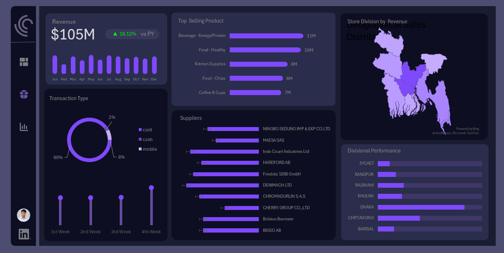
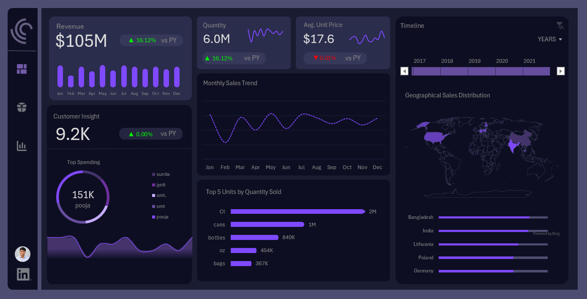

# 📊 E-Commerce Sales Analysis Dashboard

## Project Overview
An interactive sales analytics dashboard developed to analyze e-commerce revenue, product performance, customer insights, payment methods, suppliers, and geographical sales distribution.

The project transforms sales data into meaningful visualizations to support data-driven business decisions.

## 📌 Key Performance Indicators (KPIs)
- **Total Revenue:** $105M
- **Total Quantity Sold:** 6.0M
- **Average Unit Price:** $17.6
- **Customer Insight Metric:** 9.2K

*Values are displayed as shown in the dashboard.*

## 📈 Dashboard Features
- Monthly Revenue Trends
- Top-Selling Products by Quantity
- Transaction Type Distribution
- Supplier Performance Analysis
- Geographical Sales Distribution
- Divisional Sales Performance
- Top Customers by Spending
- Year-wise Sales Analysis

## 🔍 Key Insights
- Revenue is approximately $105M, with a displayed year-over-year increase of 16.12%.
- Beverage – Energy/Protein is the leading product category by quantity, at approximately 11M.
- Cart payments represent the largest transaction type in the displayed distribution.
- Geographical and divisional comparisons help identify differences in sales performance.
- Customer spending analysis highlights high-value customers.

## 🛠️ Tools Used
- Microsoft Excel
- Pivot Tables and Pivot Charts
- Data Cleaning
- Dashboard Design
- Data Visualization

## 💼 Business Impact
This dashboard helps businesses monitor revenue trends, compare product performance, understand payment preferences, and identify geographical sales opportunities.

## 📷 Dashboard Preview

## 👨‍💻 Author
Subrata Bera
